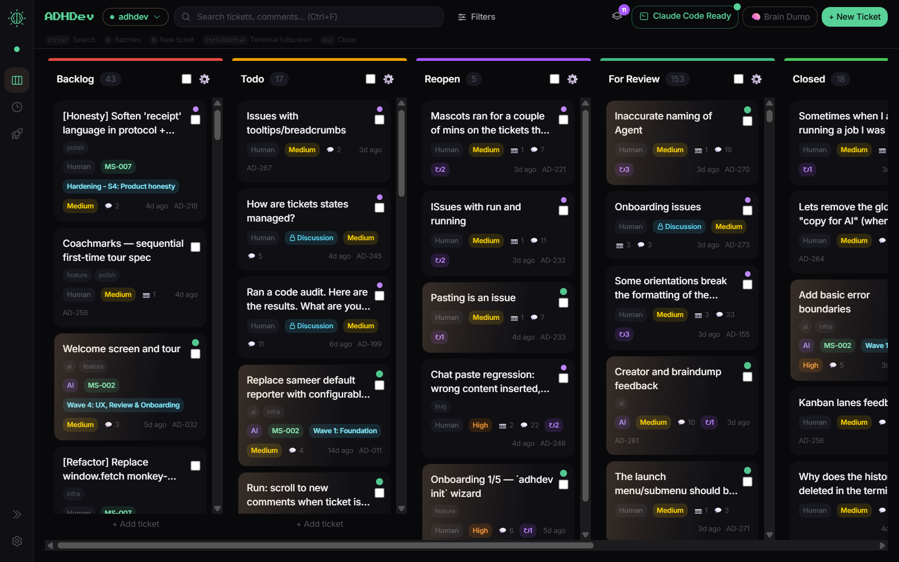

# ADHDev

**The human context window is the real bottleneck.**

ADHDev is the board that holds what your brain can't — when you're shipping software with AI. You queue work. The AI does it. You review. The board keeps everything straight.



## Quick start

```bash
npm install -g adhdev-board
adhdev init
adhdev start
```

The board opens at `localhost:3111` and `.adhdev/` is created in your project. That's it.

## What it does

Four things your brain drops when an AI is doing the work:

**Memory.** What the AI did yesterday is preserved — ticket by ticket, comment by comment, file by file. Open a ticket and you see the whole history. No re-explaining where you left off.

**Sequencing.** Work runs in the right order, not in random order. Tickets have status. Reopens get priority. The board enforces a queue so you're not picking what to look at next every five minutes.

**Verification.** The AI doesn't get to mark its own homework. An agent can flip a ticket to *done* — but only you can move it to *reviewed*. And in a git repo, every "files touched" claim is ground-truthed against `git diff`, not taken on the agent's word. (Outside a git repo it falls back to the agent's self-report, labeled as such.)

**Chronology.** Reopens get the full history, no backwards-guessing. If a fix didn't hold, the agent picks up the ticket with every prior comment loaded — yours and the AI's — so it knows what was tried and what failed.

## While the AI works, you keep working

You queue the next ticket. Review the last one. Look at the bug from yesterday. The agent doesn't need you holding its hand. You don't have to sit and watch.

## Who it's for

- People shipping software with AI who don't think of themselves as engineers — product folks, designers, founders, indie builders.
- People using Claude Code or another agent CLI who want work tracked without writing JIRA tickets by hand.
- Anyone tired of "the AI said done, but it isn't."

## Who it's not for

- Engineers running ten parallel agents with git worktrees. You're already past this; you don't need it.
- Enterprise compliance shops. No SSO, no audit log infrastructure, no SOC2.
- Line-by-line code reviewers. The board surfaces what changed and what the AI claimed. If you read every byte of every commit anyway, this adds friction without value.

## Requirements

- Node.js 18+
- [Claude Code](https://docs.anthropic.com/claude/docs/claude-code) for the one-click Run button. The board works without it — you just trigger your agent however you usually do.
- Windows, macOS, or Linux

## Local-first

Your data stays in your repo. No accounts. No cloud. **We never see your board content, tickets, code, or file paths.**

On startup the app makes a single request to a version manifest (so we can ship updates and security fixes, and flip a killswitch if a release is broken). That request carries a small amount of **anonymous** diagnostic data:

- a random install ID (generated locally, not tied to you or your machine name),
- the app version, your OS / architecture, and Node version,
- the coarse location your network IP resolves to — the same thing every website you visit already sees.

It's used only for aggregate counts: how many installs are out there, which versions and platforms are in use. **No board content, no tickets, no code, no file paths, no accounts — and we never track what you do inside the board.**

Opt out any time:

- `ADHDEV_NO_ANALYTICS=1` — drops the anonymous diagnostics (still checks for updates).
- `ADHDEV_NO_UPDATE_CHECK=1` — turns off the startup request entirely.

## Free vs paid

ADHDev's local product is free. Forever.

A hosted cloud tier is on the roadmap for teams that want a shared board across machines. The cloud tier is purely additive. It does not gate any feature that exists in the local product today.

| Feature | OSS (free) | Cloud (coming) |
|---|:---:|:---:|
| Local Kanban board | ✅ | ✅ |
| Run tickets through your agent CLI | ✅ | ✅ |
| Codebase auto-scan, draft tickets | ✅ | ✅ |
| Per-project local storage (`.adhdev/`) | ✅ | ✅ |
| Multi-machine sync | — | ✅ |
| Team boards, shared projects | — | ✅ |
| Hosted runs (no local agent needed) | — | ✅ |

## Troubleshooting

### The embedded terminal won't start

The in-app terminal uses [`node-pty`](https://github.com/microsoft/node-pty), a
native module. It installs a prebuilt binary when one exists for your
platform/Node version; otherwise npm compiles it with `node-gyp`, which needs a
C/C++ build toolchain. On machines without a prebuilt binary **and** without
build tools, that step fails and `node-pty` can't load.

**This only affects the embedded terminal pane.** The rest of ADHDev works
normally — board, tickets, comments, brain-dump, and the **Run** button (which
hands you the prompt to paste). Just run your coding agent in your own terminal.

To get the embedded terminal back, rebuild the native module:

```bash
npm rebuild node-pty
```

If that still fails, install your platform's build tools, then rebuild:

- **macOS:** `xcode-select --install`
- **Debian/Ubuntu:** `sudo apt-get install -y build-essential python3`
- **Windows:** the "Desktop development with C++" workload from Visual Studio
  Build Tools (most Windows setups ship a prebuilt binary and never hit this).

Then restart `adhdev`; the pane's **Retry** button reconnects once the rebuild
succeeds. The terminal server reports `{"terminalAvailable": false, "terminalReason": "..."}`
at `http://localhost:3112/status` while it's degraded.

## Links

- [GitHub Issues](https://github.com/sameernoorani1/adhdev/issues)
- [Contributing](CONTRIBUTING.md)
- [Code of Conduct](CODE_OF_CONDUCT.md)
- [Self-hosting from source](SELF_HOSTING.md)

## License

[AGPL-3.0-or-later](LICENSE) — see [LICENSING.md](LICENSING.md) for the dual-licensing setup (open-source + commercial available).
